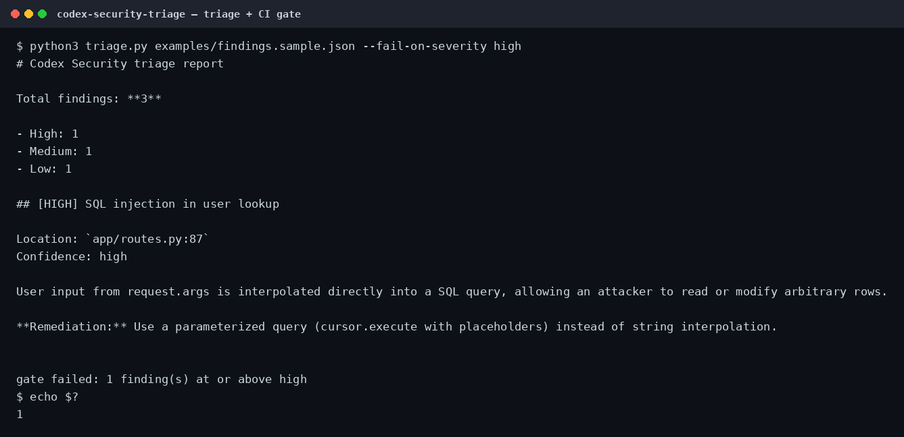

# codex-security-triage



**Turns a `codex-security` findings file into a fix-first triage report — and a CI gate that fails the build on a high finding — in 0.05 seconds, with zero dependencies.**

Scanners hand you JSON; humans need to know *what to fix first*. This tool reads the `findings.json` or SARIF export that OpenAI's [`codex-security`](https://github.com/openai/codex-security) scanner writes, sorts it worst-first with file:line, confidence and a remediation for every finding, and exits non-zero when anything meets your severity threshold — so the same report you read in the morning is the gate that blocks the merge at night.

## Why now

This week is a triage week. On 2026-11-18 Wiz Research disclosed two unauthenticated remote-code-execution flaws in NGINX's HTTP/2 handling — **CVE-2026-123633** and **CVE-2026-123007**, both **CVSS 4.0 9.2** (fixed in NGINX 1.30.7 / 1.31.9) — the same day Terra Security published a KVM guest-to-host memory read (**CVE-2026-99312**, AMD nested SVM), and Ruby shipped emergency patches (4.0.10 / 3.4.13 / 3.3.14) for seven Regexp and String vulnerabilities, several with RCE proof-of-concepts. When a week like this drops, every team re-runs its scanners — and then drowns in the output. This tool is the 30-second step between "scan finished" and "we know what to fix first".

## Quick start — 30 seconds, from zero

```bash
git clone https://github.com/Mahgal/codex-security-triage.git
cd codex-security-triage
python3 triage.py examples/findings.sample.json
```

No install step: pure Python 3 standard library, no pip packages, no API key, no network. (Verified on Python 3.12.3; the commands above are the exact ones run for the demo below.)

```bash
# Fail CI when anything is high or worse — exit 1, report still printed
python3 triage.py findings.json --fail-on-severity high --output report.md

# Machine-readable output for your own pipeline
python3 triage.py results.sarif --format json
```

Exit codes: `0` gate passed · `1` a finding met `--fail-on-severity` · `2` bad input.

## What it looks like

Real output from the included sample (3 findings: 1 high, 1 medium, 1 low) — run on 2026-11-19, rendered in **0.054 s**:

```
$ python3 triage.py examples/findings.sample.json --fail-on-severity high
# Codex Security triage report

Total findings: **3**

- High: 1
- Medium: 1
- Low: 1

## [HIGH] SQL injection in user lookup

Location: `app/routes.py:87`
Confidence: high

User input from request.args is interpolated directly into a SQL query, allowing an attacker to read or modify arbitrary rows.

**Remediation:** Use a parameterized query (cursor.execute with placeholders) instead of string interpolation.

## [MEDIUM] Session cookie missing Secure flag

Location: `app/auth.py:54`
Confidence: medium

The session cookie is set without the Secure flag, so it can be sent over plain HTTP on networks that allow downgrade.

**Remediation:** Set Secure=True (and HttpOnly) when creating the session cookie.

## [LOW] Stack trace exposed in error response

Location: `app/errors.py:12`
Confidence: low

Error responses include a full stack trace, which leaks internal file paths and library versions.

**Remediation:** Return a generic error message to clients and log the stack trace server-side.
```

And the gate, on the same run:

```
gate failed: 1 finding(s) at or above high
$ echo $?
1
```

## Measured, not claimed

| Check | Result | How |
|---|---|---|
| Test suite | **7/7 passed in 0.269 s, exit 0** | `python3 -m unittest discover -s tests -v` |
| Report render (3 findings) | **0.054 s, exit 0** | `python3 triage.py examples/findings.sample.json` |
| Gate, `--fail-on-severity high` | **exit 1 in 0.053 s** | 1 finding at or above high |
| Gate, `--fail-on-severity critical` | **exit 0** | nothing at critical |
| JSON output | **exit 0, total 3** | `--format json`, parsed back |
| Bad input (`nonexistent.json`) | **exit 2** | `error: [Errno 2] No such file or directory` |

Tests cover both input formats, the gate in both directions, `--output` file writing, and JSON output — stdlib `unittest` only, no test dependencies.

## Input formats

- **findings.json** — a list, or `{"findings": [...]}`. Each finding uses `severity` (`critical|high|medium|low|info`), `title`, `file`, `line`, `description`, `remediation`, `confidence`.
- **SARIF v2.1.0** — `runs[].results[]` with rule metadata, detected by the presence of a top-level `runs` key. SARIF `error`/`warning`/`note`/`none` levels map to high/medium/low/info.

## Honest scope and limits

- **This is not a scanner.** It reads output files from `codex-security` (or any tool that writes the same shapes); it never scans code itself and never calls an API.
- **The sample findings are modelled, not a real scan** — they follow the fields `codex-security` documents (severity, confidence, locations, remediation) so you can try the tool without running a scanner first.
- **Severity is passed through, not re-scored.** Unknown severity strings are normalized to `info`; SARIF findings without a rule entry fall back to the result level.
- **No exploitability or reachability analysis.** A "high" finding is high because the scanner said so — the report orders your fix list, it doesn't re-judge the scanner.
- **Confidence is reported as-is** (`high`/`medium`/`low`/`unknown`); the tool doesn't recompute it.

## Why this instead of reading the JSON?

`findings.json` is machine-shaped: great for pipelines, painful for the person deciding what to fix first. This tool gives you the same data worst-first, one screen per finding, with the remediation attached — and the same `--fail-on-severity` semantics the scanner uses, so the report and the gate can never disagree.

## License

MIT — see [LICENSE](LICENSE).
